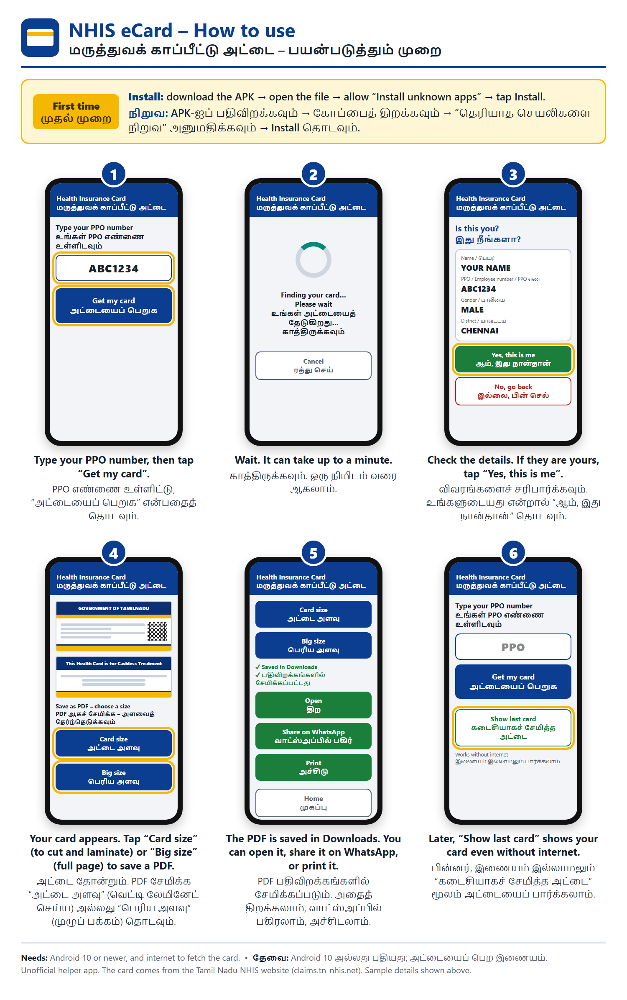

# NHIS eCard

A small Android app that gets your Tamil Nadu New Health Insurance Scheme (NHIS) e-card from your PPO number and saves it as a PDF. It is made for elders: one box to type in, large buttons, and every label in English and Tamil.

**[⬇ Download the app (APK)](https://github.com/Shadow-Borg/nhis-ecard-app/releases/latest/download/NHIS-eCard.apk)**

Direct link: `https://github.com/Shadow-Borg/nhis-ecard-app/releases/latest/download/NHIS-eCard.apk`

> This is an unofficial helper app. It is not made by or connected with the Government of Tamil Nadu, United India Insurance or Medi Assist. The card itself comes from the official NHIS website, [claims.tn-nhis.net](https://claims.tn-nhis.net/nhis/Payer/PayerMembersearch.aspx).

## How to use

**[▶ Watch the 46-second video](docs/how-to-use.mp4)** – best on a phone. No sound; captions in English and Tamil.
To send it on WhatsApp, download the file: `https://github.com/Shadow-Borg/nhis-ecard-app/releases/latest/download/NHIS-eCard-how-to-use.mp4`

The same steps as one printable sheet:



### Install (first time only)

1. Open the download link above on the Android phone.
2. Open the downloaded file `NHIS-eCard.apk`.
3. If the phone asks, allow **Install unknown apps** for your browser or file manager.
4. Tap **Install**, then **Open**.

### Get the card

1. **Type your PPO number** in the box and tap **Get my card / அட்டையைப் பெறுக**.
2. **Wait.** The app searches the NHIS website for you. This can take up to a minute.
3. **Check the details.** The app shows the name, PPO number, card number, gender and district it found.
   - If they are yours, tap **Yes, this is me / ஆம், இது நான்தான்**.
   - If not, tap **No, go back / இல்லை, பின் செல்** and check the number.
4. **Your card appears**, front on top and back below. Choose a PDF size:
   - **Card size / அட்டை அளவு** – both sides at real ID-card size with dashed cut lines, for cutting out and laminating.
   - **Big size / பெரிய அளவு** – both sides filling an A4 page, easy to read.
5. **The PDF is saved in the phone's Downloads folder.** Three buttons then appear:
   - **Open / திற** – view the PDF.
   - **Share on WhatsApp / வாட்ஸ்அப்பில் பகிர்** – send it to someone.
   - **Print / அச்சிடு** – print it on A4 paper.
6. **Later, without internet:** tap **Show last card / கடைசியாகச் சேமித்த அட்டை** on the first screen. The app keeps the last card it fetched.

### If something goes wrong

| What you see | What to do |
| --- | --- |
| "No card found for … Please check the number." | The NHIS website has no member with that number. Check the PPO number and try again. |
| "Could not reach the NHIS website." | Check the internet connection and tap **Try again**. |
| The same message keeps coming | Tap **Open the website**. The app shows the real NHIS website so you can search by hand; when you press "Generate e-Card" there, the app takes over again. |

## Good to know

- Works on **Android 10 or newer**.
- Needs internet to fetch a card. Viewing the last card works offline.
- The app does not remember the PPO number you type. It keeps only the last card image, inside the app, for offline viewing.
- The app talks only to `claims.tn-nhis.net`. It has no accounts, ads or tracking.
- The NHIS website needs no login, so anyone who knows a PPO number can see that member's card. The app does the same as the website.
- If the NHIS website changes its pages, the automatic steps may stop working until the app is updated. The **Open the website** fallback still works.

## Build it yourself

Plain Java, one activity, no third-party libraries.

```bash
./gradlew assembleRelease
```

The APK is written to `app/build/outputs/apk/release/app-release.apk`. Requires JDK 17 and the Android SDK (platform 34). The release build is signed with the debug key, which is enough for sideloading.

The how-to image is generated from [`docs/how-to-use.html`](docs/how-to-use.html) and the video from [`docs/how-to-use-video.html`](docs/how-to-use-video.html). Both use sample member details.
